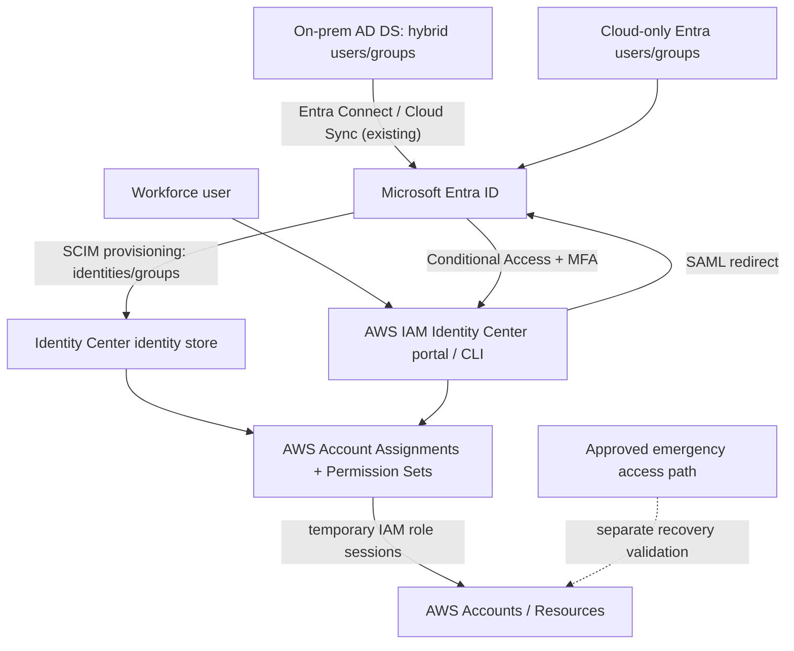

# AWS Workforce Identity Federation with Microsoft Entra ID

> **IP-21 | Repeatable Service Package**

**Expected Outcome:** เชื่อม AWS IAM Identity Center เข้ากับ Microsoft Entra ID ผ่าน SAML SSO และ SCIM Provisioning พร้อมกำหนด Conditional Access/MFA, Group-to-Permission Set Mapping, Identity Lifecycle และ Emergency Access ที่ตรวจสอบได้

**Customer Brochure:** [AWS Workforce Identity Federation — Scope, 6 Person-Days, Tools & Sample Reports](brochures/ip-21-aws-workforce-identity-federation.md)

## When to Engage

- ลูกค้ามี On-premises AD DS Sync ไป Microsoft Entra ID และมี Conditional Access + MFA อยู่แล้ว แต่ Workforce Users ยัง Sign in AWS ด้วย IAM Users หรือบัญชีแยก
- ต้องการ Central SSO และ Group-driven Access สำหรับหลาย AWS Accounts โดยใช้ Corporate Identity ที่มีอยู่
- IAM Identity Center ยังใช้ Directory ในตัว หรือ Federation เดิม และต้องตรวจ Migration Risks ก่อนเปลี่ยน Identity Source
- Joiner/Mover/Leaver หรือ Privileged AWS Access ยังไม่สอดคล้องกับ Identity Governance ของ Microsoft Entra

## Decisions & Outcomes

- มี **Current-State & Target Federation Architecture** ของ AD → Entra → AWS (Authentication vs Provisioning vs Authorization)
- ได้ **SAML + SCIM Pilot Configuration** และผลทดสอบ SSO, CA/MFA, Membership และ AWS Access Assignments
- กำหนด Group-to-Account-to-Permission-Set Matrix, Access Owners, Provisioning Scope และ Offboarding Behavior
- ประเมิน Emergency/Privileged Access, Certificate/Token Rotation, Session Durations, Exceptions และ Recovery Path ก่อน Rollout

## Scope & Delivery

| Phase | Typical Activities | Target Evidence |
|---|---|---|
| Assess | Review Entra Identity Sync/Groups, Enterprise Apps, CA/MFA, IAM Identity Center Identity Source/Assignments | Identity & Dependency Inventory |
| Design | SAML/SCIM Trust, NameID/Attribute Mapping, CA Scope, Group-to-Permission Sets, Emergency Access | Design & Governance Matrices |
| Configure | Approved Pilot SAML Trust, SCIM Provisioning, Pilot Groups/Assignments, Supported CA/MFA Policies | Configuration Record |
| Validate | Browser/CLI SSO, MFA/Denied Sign-in, SCIM Update/Deactivate, IAM Allow/Deny, Recovery Scenarios | Test Register & Risk Exceptions |
| Handover | Logging/Operations, Key/Cert Rotation, Access Review, Lifecycle Workflow, Pilot-to-Production Roadmap | Runbook & Go/No-Go Recommendation |

**Reference Delivery: 6 Person-Days** สำหรับ Approved Pilot โดยไม่รวม Production Identity Source Cutover ที่มี Dependencies ซับซ้อน การสร้าง Independent Emergency Access Infrastructure ใหม่ทั้งระบบ หรือ Full Enterprise Rollout

## Architecture Mental Model

**System question:** Who authenticates workforce identities, who provisions account records, and who authorizes access to AWS resources?

**Control boundary:** SAML ทำ Authentication, SCIM ทำ Identity Provisioning และ AWS IAM Identity Center/IAM จัดการ Authorization; Microsoft Entra CA ไม่ใช่ AWS API-level Policy และไม่ได้ป้องกัน Direct IAM Users/Root/Workload Roles โดยตรง

## Decision & Recovery Gates

| Gate | Required Evidence | Hold / No-Go Condition |
|---|---|---|
| Identity Source Readiness | Current IAM Identity Center source, users/groups/assignments inventory | มีการเปลี่ยน Source โดยไม่ทราบ Impact |
| SAML Trust | Metadata, NameID/Email Matching, Certificate Owner/Expiry, Test User | SSO ไม่เสถียรหรือ Recovery Access ไม่พร้อม |
| SCIM Provisioning | Assigned groups, Attribute Mapping, Token Owner, Create/Update/Disable tests | Membership mismatch หรือ Deprovision เสี่ยงกระทบบัญชีอื่น |
| CA/MFA & Privileges | AWS Enterprise App CA scope, MFA Results, Approved Admin Group | Privileged Access Bypass หรือ Lockout Risk |
| Authorization | Actual AWS Allowed/Denied Tests, Permission Set assignments | Denied required work / allowed prohibited work |
| Outage / Emergency | IAM Identity Center Outage vs Entra IdP Outage scenarios | ไม่มี Independent Recovery Path สำหรับเหตุขัดข้องที่เป็นไปได้ |

### Critical Design Notes

- **Identity Source Change:** AWS IAM Identity Center มีเพียงหนึ่ง Identity Source ต่อ Organization การเปลี่ยน Source อาจลบ Users/Groups/Assignments หรือ Permission-Set Roles ตามชนิดการเปลี่ยน ต้องสำรวจก่อน และแยก Cutover Plan
- **SCIM Group Membership:** Provisioning ใน Entra ไม่รองรับการขยาย Nested Groups และการเปลี่ยน Membership มี Delay (รวมถึง PIM Activation/Deactivation); ต้องตรวจ Lifecycle Tests
- **Role Sessions:** การ Disable/Remove Access ใน IdP ไม่ได้ทำให้ AWS IAM Role Session ที่ออกไปแล้วสิ้นสุดทันที ต้องประเมิน Session Duration และ Incident Procedures
- **Emergency Access:** AWS แนะนำ Emergency Access ที่อาจใช้ IdP เดิมเมื่อ Identity Center ขัดข้อง; หาก Entra ID ขัดข้องด้วย ต้องมี Independent Route ต่างหาก
- **Secrets/Credentials:** ห้ามบันทึก SCIM Bearer Token, Certificates' Private Keys หรือ Login Secrets ใน GitHub/Report

## Deliverables

Current-State & Readiness Assessment, Federation/Provisioning Architecture, Conditional Access & AWS Permission Set Matrix, Approved Configuration Register, Pilot Validation & Go/No-Go Evidence และ Identity Operations/Recovery Runbook

**Sample Deliverable:** [View AWS–Entra Workforce Federation Outcome (Fictional Pilot)](examples/aws-entra-workforce-federation-outcome.md)

## Engineering Assurance

- ใช้ Pilot Security Groups และ Limited AWS Accounts ก่อนขยายผล
- เปลี่ยน SAML Identity Source เฉพาะเมื่อ Impact และ Rollback/Recovery พร้อม
- ทดสอบ Required Allow + Prohibited Deny, SCIM Lifecycle และ Privileged/Emergency Paths
- แยก Pilot Sign-off ออกจาก Enterprise Rollout; รายการที่ยังไม่มีหลักฐานต้องเป็น Open Risk ไม่ใช่ Completed

## Assumptions & Boundaries

ไม่รวมการเปลี่ยน On-prem AD Sync, Domain Federation ของ Microsoft 365, Application Code, Organization-wide IAM Policy Cleanup (IP-05), การแก้ Workload Credentials และ Full IAM Identity Center Migration หากต้อง Rebuild Existing Assignments/Roles

License Conditional Access/PIM, AWS Account/Org Permissions และ Logging Retention ต้องตรวจตาม Tenant/Environment จริงก่อนดำเนินงาน

## Getting Started

เตรียม AWS Organizations / IAM Identity Center Information, Existing Identity Source, Entra Enterprise Applications/CA Overview, Pilot Group/Account Owners, Access Assignment Inventory และ Change Approval/Recovery Contacts

## References

- [AWS — Configure SAML and SCIM with Microsoft Entra ID](https://docs.aws.amazon.com/singlesignon/latest/userguide/idp-microsoft-entra.html)
- [AWS — Considerations for Changing Identity Source](https://docs.aws.amazon.com/singlesignon/latest/userguide/manage-your-identity-source-considerations.html)
- [AWS — Understanding Authentication Sessions](https://docs.aws.amazon.com/singlesignon/latest/userguide/authconcept.html)
- [AWS — Emergency Access](https://docs.aws.amazon.com/singlesignon/latest/userguide/emergency-access-implementation.html)
- [Microsoft — Automatic Provisioning to AWS IAM Identity Center](https://learn.microsoft.com/en-us/entra/identity/saas-apps/aws-single-sign-on-provisioning-tutorial)

**[ติดต่อทีม In The Cloud](mailto:info@inthecloud.co.th?subject=IP-21%20AWS%20Workforce%20Federation)**

---

*Conceptual design and fictional examples only; no production identity data, credentials, or account topology published.*
